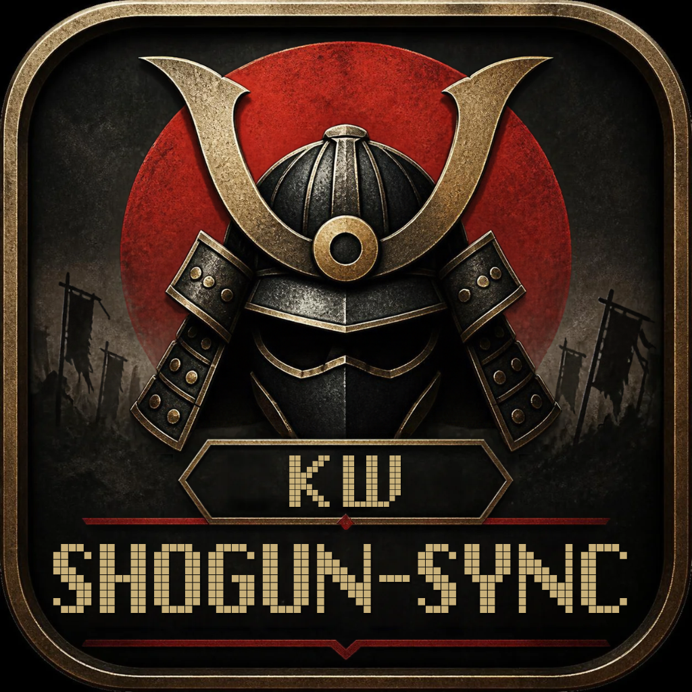
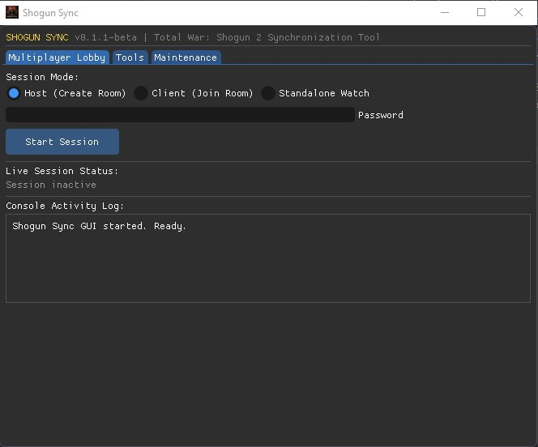

<div align="center">



# Shogun-Sync

> An unofficial multiplayer save synchronization and desynchronization recovery tool for **Total War: Shogun 2**.  
> **Website & Downloads:** [https://shogun2-sync.com](https://shogun2-sync.com)

[](https://en.wikipedia.org/wiki/C_(programming_language))
[](https://www.microsoft.com/windows)
[](https://www.gnu.org/licenses/old-licenses/gpl-2.0.en.html)
[]()
[](https://shogun2-sync.com)

</div>

> [!NOTE]
> **Beta Notice**: Shogun-Sync is currently in beta. If you encounter any bugs, unexpected behavior, or desync issues during your campaigns, please report them on [GitHub Issues](https://github.com/KolajW/shogun2-sync/issues).  
> For installer downloads, quickstart guide, and documentation, visit [**shogun2-sync.com**](https://shogun2-sync.com).

---

## Overview

**Shogun-Sync** is an open-source tool created to fix multiplayer campaign desyncs in *Total War: Shogun 2*.

During co-op or head-to-head campaigns, small simulation differences can cause host and guest saves to fall out of sync. When this happens, turns won't progress or players get stuck. Normally, players have to exit the game, locate save files in AppData, and manually copy `.save_multiplayer` files over Discord or USB.

**Shogun-Sync handles this automatically:**
1. **Save monitoring**: Detects when Shogun 2 updates campaign saves at the end of each turn.
2. **Hash comparison**: Compares save checksums between players through a lightweight relay server.
3. **Save transfer**: If a desync is detected, the host automatically sends the authoritative save to the guest over WebSocket.
4. **Save written to disk**: The client writes the synchronized save into `save_games_multiplayer`. Because Shogun 2 multiplayer cannot reload saves mid-match, players simply return to the lobby and rehost or load with the updated save file — no manual file copying required.
5. **In-game overlay**: Displays turn count, room code, and sync status directly on screen.

---

## Project Components & Binaries

| Binary | Description |
| :--- | :--- |
| **`ShogunSync-Setup.exe`** | Standard installer (recommended). Installs to `%LOCALAPPDATA%\ShogunSync`, adds Start Menu/Desktop shortcuts, sets up PATH, and imports the certificate. |
| **`ShogunSyncSetup.exe`** | Standalone Win32 installation wizard. |
| **`ShogunSync.exe`** | Launcher that opens the GUI without leaving a console window open. |
| **`shogun-sync.exe`** | Core CLI tool, background watcher, and embedded GUI. |
| **`shogun_overlay32.dll`** | 32-bit in-game HUD overlay for DirectX 9 and DirectX 11. |

---

## Graphical User Interface (GUI)

The desktop interface allows you to create or join rooms, monitor synchronization status, and inject the in-game overlay:



---

## In-Game Overlay & Hotkeys

When injected into `Shogun2.exe`, the overlay displays status information and provides hotkeys:

* **`F10`**: Toggles the HUD menu on and off.
* **`F9`**: Triggers a save sync to disk. On the client, requests the host's save; on the host, sends the save to connected clients.
* **HUD Telemetry Banner**: Shows the current turn, room code, role, and sync status:
  * `[ SYNC OK ]` – Both saves match.
  * `[ DESYNC DETECTED ]` – Save checksums differ.
  * `[ RESYNCING ]` – Receiving and saving the host file.
  * `[ SAVE SYNCED ]` – Save written to disk. Rehost or load from lobby to continue.

---

## Installation

### Option 1: Standard Installer (`ShogunSync-Setup.exe`, Recommended)

1. Download **`ShogunSync-Setup.exe`** from [shogun2-sync.com/#downloads](https://shogun2-sync.com/#downloads) or GitHub Releases.
2. Run the installer:
   * Installs to `%LOCALAPPDATA%\ShogunSync` (no administrator privileges required).
   * Automatically closes running game or sync processes before updating.
   * Configures user `PATH` and desktop/Start Menu shortcuts.
   * Imports the signing certificate to `TrustedPublisher` via `certutil`.

### Option 2: Standalone Setup Wizard (`ShogunSyncSetup.exe`)

1. Download **`ShogunSyncSetup.exe`** from the website or GitHub releases.
2. Run the wizard to extract the files and configure shortcuts.

### Option 3: Portable ZIP Archive

1. Download the `.zip` archive containing the binaries, scripts, and documentation.
2. Extract to any folder, or run `install.bat` to set up `%LOCALAPPDATA%\ShogunSync` and PATH.

---

## Quick Start Guide

### Mode A: Graphical User Interface (GUI)

1. Launch **`ShogunSync.exe`** (or use the desktop shortcut).
2. **Multiplayer Lobby Tab**:
   * Select **Host (Create Room)** or **Client (Join Room)**.
   * Enter your chosen password (and Room Code if joining as Client).
   * Click **Start Session**.
3. **Tools Tab**:
   * Click **Inject In-Game Overlay** once *Total War: Shogun 2* is running.
   * If manual sync is ever needed, click **Sync Save to Disk (F9)**.

---

### Mode B: Command-Line Interface (CLI)

#### 1. Initial Setup (One-time)
```cmd
shogun-sync init
```
*Creates the local `.sync` repository structure in `%APPDATA%\The Creative Assembly\Shogun2\`.*

#### 2. Host Creates a Room
```cmd
shogun-sync create MySecretPass123
```
Output:
```text
Room code: K7P9X2
Password: MySecretPass123
Connected with lobby
Waiting for turn changes... (Press CTRL + C to exit)
```
*Share the 6-character room code and password with your partner.*

#### 3. Client Joins the Room
```cmd
shogun-sync join K7P9X2 MySecretPass123
```

#### 4. Inject Overlay (Optional but Recommended)
In a separate terminal (or via the GUI):
```cmd
shogun-sync inject
```

---

## Command Line Reference

```text
Usage: shogun-sync [command] [options]

Commands:
  --gui, -g                  Launch graphical user interface
  init                       Initialize synchronization directories and local CAS repository
  create <password>          Create a multiplayer room with an auto-generated 6-character code
  join <room_code> <pass>    Join an existing multiplayer room
  commit                     Manually create a local save snapshot commit
  --watch, -w                Watch save directory for changes (offline standalone mode)
  --scan, -s                 Scan and count save files in multiplayer directory
  --tscan, -ts               Scan and list names of all detected multiplayer saves
  inject [dll_path]          Inject DirectX HUD overlay into running Shogun2.exe process
  reload [save_name]         Trigger in-game save reload via overlay IPC
  update, -u                 Check for and install software updates
  uninstall                  Cleanly uninstall Shogun-Sync from system
  --version, -v              Display version information
  --help, -h                 Display help and usage instructions
```

---

## Diagnostics & Error Codes Matrix

When an issue occurs, Shogun-Sync outputs a standardized 3-digit error code:

| Code | Identifier | Description & Resolution |
| :---: | :--- | :--- |
| **001** | `SAVE_NOT_FOUND` | Save file does not exist in directory. Play one turn to create an autosave. |
| **002** | `FILE_WRITE_FAILED` | Failed to write file stream to disk. Verify folder permissions and disk space. |
| **003** | `COMPRESSION_FAILED` | Zlib compression stream error during deflate operation. |
| **004** | `COMPRESSION_INIT_FAILED` | Zlib `deflateInit` initialization failure. |
| **005** | `APPDATA_NOT_FOUND` | `%APPDATA%` environment variable missing or variable initialization failed. |
| **006** | `LOCALAPPDATA_NOT_FOUND` | `%LOCALAPPDATA%` environment variable missing in operating system. |
| **007** | `INIT_FAILED` | Failed to create hidden `.sync` metadata storage directory. |
| **008** | `SCAN_FAILED` | Failed to open or read the save games folder via Win32 API. |
| **009** | `CTRL_HANDLER_FAILED` | Win32 console control handler failed to attach via `SetConsoleCtrlHandler`. |
| **010** | `DECOMPRESS_INIT_FAILED` | Zlib `inflateInit` initialization failure. |
| **011** | `DECOMPRESS_STREAM_FAILED`| Zlib decompression stream error or incomplete stream. |
| **012** | `DECOMPRESS_WRITE_FAILED` | Failed to write restored uncompressed save data to game directory. |
| **013** | `DECOMPRESS_OPEN_FAILED` | Could not open compressed blob file for inflation. |
| **014** | `HOSTNAME_FAILED` | Windows Sockets failed to resolve local machine hostname. |
| **015** | `CONN_FAILED` | WebSocket connection to relay broker failed or timed out. Check internet connection. |
| **016** | `INVALID_PACKET` | Malformed packet received or path traversal sequence detected. |
| **017** | `MEMORY_ALLOC_FAILED` | Heap memory allocation (`malloc`) failed due to memory exhaustion. |
| **018** | `COMMIT_FAILED` | Failed to write commit manifest or update reference pointer (`refs/latest`). |
| **019** | `RESYNC_RESTORE_FAILED` | Failed to decompress save file during Auto-Resync. |
| **020** | `INVALID_ARGUMENTS` | Missing or invalid command line parameters (e.g. room code or password). |
| **021** | `SHARED_MEMORY_FAILED` | Failed to create named shared memory mapping (`Local\ShogunSyncIPC`). |
| **022** | `MEMORY_VIEW_FAILED` | Failed to map view of IPC shared memory buffer (`MapViewOfFile`). |
| **023** | `PROCESS_NOT_FOUND` | Target process `Shogun2.exe` is not currently running. |
| **024** | `PROCESS_OPEN_FAILED` | Failed to obtain process handle with `PROCESS_ALL_ACCESS` rights. |
| **025** | `REMOTE_ALLOC_FAILED` | Virtual memory allocation in target process failed (`VirtualAllocEx`). |
| **026** | `REMOTE_WRITE_FAILED` | Writing DLL path into target process memory failed (`WriteProcessMemory`). |
| **027** | `REMOTE_THREAD_FAILED` | Spawning remote thread in game process failed (`CreateRemoteThread`). |
| **028** | `OVERLAY_NOT_FOUND` | Target overlay DLL (`shogun_overlay32.dll`) not found on disk. |
| **029** | `REMOTE_LOAD_FAILED` | Injected overlay DLL failed to load in remote process space. |
| **030** | `UPDATE_CHECK_FAILED` | Failed to query remote endpoint for latest software version. |
| **031** | `UPDATE_DOWNLOAD_FAILED` | WinINet failed to download update payload from remote URL. |
| **032** | `UNINSTALL_FAILED` | Uninstallation routine failed to clean user environment variables or directories. |
| **033** | `SELF_REPLACE_FAILED` | Atomic file replacement failed during in-place upgrade. |
| **034** | `INSTALLATION_FAILED` | Setup wizard failed to extract embedded resources or register shortcuts. |

*Detailed diagnostics and troubleshooting matrices are documented in [`docs/errors.pdf`](docs/errors.pdf).*

---

## Technical Stack & Libraries

* **Core Language**: C99 & C++17 (compiled for 32-bit x86 Windows).
* **GUI Engine**: [Dear ImGui](https://github.com/ocornut/imgui) (v1.91.x) with Direct3D 11 and Direct3D 9 backends.
* **API Hooking**: [MinHook](https://github.com/TsudaKageyu/minhook) (v1.3.3) for Direct3D Virtual Method Table (VMT) detours.
* **Storage Engine**: Content-Addressable Storage (CAS) storing immutable Blobs, Trees, Commits, and Refs.
* **Cryptographic Hash**: Standalone implementation of **SHA-1** (FIPS PUB 180-1).
* **Compression**: [zlib](https://zlib.net/) (v1.3.2) streaming deflation and inflation.
* **Networking**: [Cesanta Mongoose](https://cesanta.com/) (v7.14) event-driven asynchronous WebSocket client with embedded TLS.
* **Platform Integration**: Native Win32 APIs (`FindFirstChangeNotificationA`, `OpenFileMappingA`, `VirtualAllocEx`, `CreateRemoteThread`, `PostMessageA`, `SetWindowLongPtrA`).

---

## License

This project is licensed under the **GNU General Public License v2.0 (GPL-2.0)**.
* **Mongoose Library** is dual-licensed by Cesanta Software under GPLv2 and commercial terms.
* **zlib** is licensed under the zlib License (Copyright © 1995–2026 Jean-loup Gailly and Mark Adler).
* **Dear ImGui** is licensed under the MIT License (Copyright © 2014–2026 Omar Cornut).
* **MinHook** is licensed under the BSD 2-Clause License (Copyright © 2009–2017 Tsuda Kageyu).

See the [LICENSE](LICENSE) file for full text.

---

## Disclaimer & Legal Notice

*Total War: Shogun 2* is a registered trademark of The Creative Assembly and SEGA. **Shogun-Sync** is an unofficial, community-developed open-source modification and synchronization utility. It is **not** created by, affiliated with, endorsed by, sponsored by, or connected in any way to The Creative Assembly, SEGA, or any of their parent companies, subsidiaries, or affiliates. All game titles, assets, and trademarks belong to their respective copyright holders.
